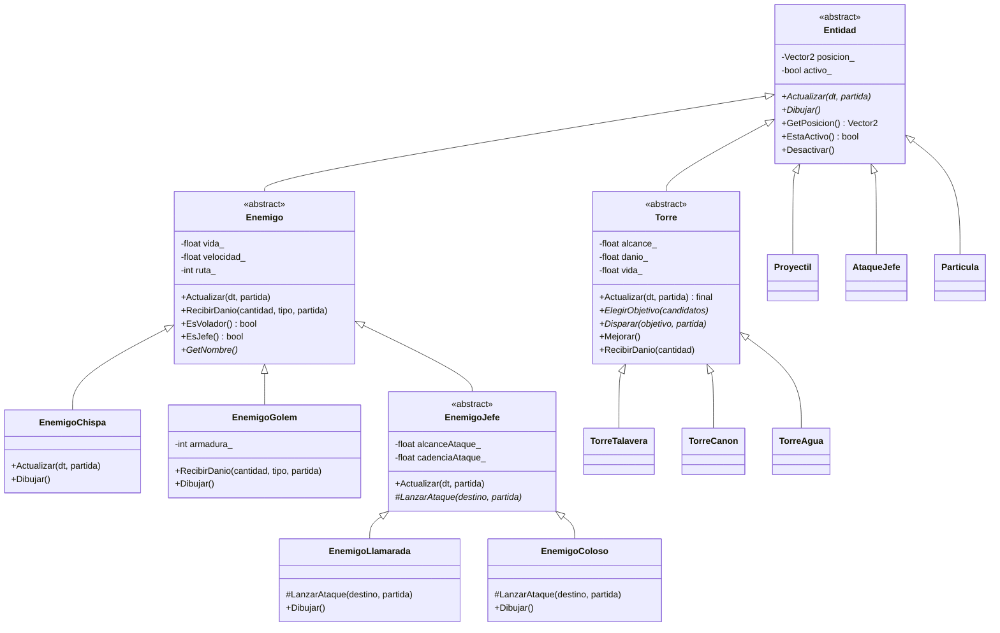
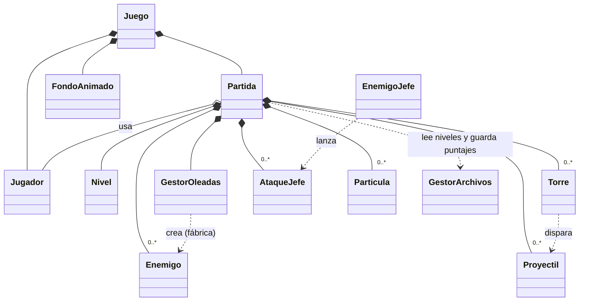

# Guardianes de Puebla: El ataque de Don Goyo

Videojuego 2D de *tower defense* hecho en **C++17** con **raylib 5.5**.

Don Goyo (el Popocatépetl) despertó y manda criaturas de fuego, piedra y lava hacia la ciudad. El jugador construye torres inspiradas en Puebla (Talavera, cantera y agua) a los lados del camino para detenerlas antes de que lleguen.

Proyecto final de **Programación Avanzada y Algoritmos**, IBERO Puebla, 2026.

**Equipo**
- Diego Navarro Sánchez
- Marco Antonio Beltrán Rosales
- Jonathan Hernández Lazcano

---

## Contenido

1. [Cómo se juega](#cómo-se-juega)
2. [Requisitos](#requisitos)
3. [¿Qué es CMakeLists.txt y por qué lo usamos?](#qué-es-cmakeliststxt-y-por-qué-lo-usamos)
4. [Compilar y ejecutar en Linux](#compilar-y-ejecutar-en-linux)
5. [Compilar y ejecutar en Windows](#compilar-y-ejecutar-en-windows)
6. [Compilar y ejecutar en macOS](#compilar-y-ejecutar-en-macos)
7. [Estructura del proyecto](#estructura-del-proyecto)
8. [Diseño orientado a objetos](#diseño-orientado-a-objetos)
9. [Archivos de nivel](#archivos-de-nivel)
10. [Cumplimiento de requisitos](#cumplimiento-de-requisitos)
11. [Problemas comunes](#problemas-comunes)
12. [Créditos de recursos](#créditos-de-recursos)

---

## Cómo se juega

### Historia
1. **Menú principal:** Nueva partida, Controles o Créditos.
2. **P1:** el abuelito te pregunta tu nombre.
3. **P2 y P3:** te cuenta que Don Goyo despertó y te pide ayuda.
4. **Nivel 1, Cholula:** 3 oleadas. En la última llega el jefe de fuego, la **Llamarada**.
5. **P4:** el abuelito te felicita y te avisa que vienen por Los Fuertes.
6. **Nivel 2, Los Fuertes:** 5 oleadas por **dos caminos**, ladrones que se roban tu bono y, al final, el **Coloso de Lava**.
7. **P5:** Don Goyo vuelve a dormir. Después vienen los créditos.

### Controles

| Tecla / ratón | Acción |
|---|---|
| Clic izquierdo en el pasto | Construir la torre elegida |
| Clic izquierdo en una torre | Seleccionarla (para mejorar o vender) |
| Clic derecho | Quitar la selección |
| `1`, `2`, `3` | Elegir Torre Talavera, Cañón de Cantera o Torre de Agua |
| `Espacio` | Lanzar la siguiente oleada |
| `U` | Mejorar la torre seleccionada (hasta nivel 3) |
| `V` | Vender la torre seleccionada (regresa la mitad de lo invertido) |
| `F` | Velocidad x1 / x2 |
| `P` o `Esc` | Pausa (en pausa, `M` regresa al menú) |
| `R` | Reintentar al terminar el nivel |
| `Enter` | Avanzar en diálogos y menús |

### Torres

| Torre | Costo | Qué hace |
|---|---|---|
| **Talavera** | $100 | Dispara rápido al enemigo más cercano a la ciudad. |
| **Cañón de Cantera** | $150 | Bala lenta que explota y daña en área. No le pega a enemigos voladores. |
| **Agua** | $120 | Ataca al enemigo con más vida y lo hace 50% más lento. Le quita armadura al Gólem. |

Cada torre se puede mejorar 2 veces: más alcance, más daño y dispara más seguido. Las torres tienen vida, y los jefes las pueden destruir.

### Enemigos

| Enemigo | Vida | Velocidad | Recompensa | Vidas que quita | Especial |
|---|---|---|---|---|---|
| **Chispa** | 45 | rápida | $8 | 1 | Avanza en zigzag. |
| **Gólem** | 340 | lenta | $25 | 3 | Armadura de 8 que reduce cada golpe. El agua se la quita. |
| **Llamarada** (jefe nivel 1) | 1600 | media | $200 | 10 | Lanza bolas de fuego a las torres cercanas. |
| **Coloso de Lava** (jefe nivel 2) | 2900 | muy lenta | $300 | 15 | Lanza rocas a las torres cercanas. |

### Reglas
- Empiezas cada nivel con dinero y **20 vidas**. Si un enemigo llega a la ciudad, pierdes vidas. Con 0 vidas, pierdes.
- Al terminar una oleada recibes un bono de `50 + 10 × número de oleada`.
- En **Los Fuertes**, El Tlacuache y La Comadreja se turnan para robarse el **50% del bono** de cada oleada.
- Cada enemigo eliminado da `recompensa × 10` puntos. Al ganar se suman `vidas × 100 + dinero sobrante`.
- El **mejor puntaje** de cada nivel se guarda en `datos/puntajes.txt`.

---

## Requisitos

| Herramienta | Para qué |
|---|---|
| Compilador de C++17 (g++, clang o Visual Studio) | Convertir el código en un programa. |
| **CMake 3.20 o más nuevo** | Organizar la compilación (ver la sección siguiente). |
| **Git** | CMake lo usa para descargar raylib automáticamente. |
| Internet (solo la primera vez) | Para descargar raylib 5.5. |

**No hace falta instalar raylib a mano.** CMake lo descarga y lo compila junto con el juego.

---

## ¿Qué es CMakeLists.txt y por qué lo usamos?

### La analogía de la receta
`CMakeLists.txt` es la **receta** del proyecto. Una receta no es el pastel; dice **qué ingredientes** se usan y **cómo se combinan**. CMake lee esa receta y prepara las instrucciones para el compilador de cada computadora: Linux, Windows o Mac.

### ¿Por qué no compilar a mano con g++?
Se podría compilar con un comando así:

```bash
g++ -std=c++17 src/*.cpp -o guardianes -lraylib -lGL -lm -lpthread -ldl -lrt -lX11
```

Pero tiene varios problemas:

| Compilando a mano con g++ | Con CMake |
|---|---|
| Cada integrante tiene que instalar raylib por su cuenta, y puede quedar con otra versión. | CMake **descarga raylib 5.5** solo. Todo el equipo usa exactamente la misma versión. |
| Las bibliotecas extra (`-lGL -lX11...`) cambian en Windows, Linux y Mac. | CMake sabe qué necesita cada sistema. |
| Cada vez se recompilan **todos** los `.cpp`, aunque solo cambies uno. | Solo recompila los archivos que cambiaron, así que es mucho más rápido. |
| Hay que recordar y escribir el comando largo cada vez. | Siempre son los mismos dos comandos cortos. |
| Visual Studio o Xcode no entienden un comando de g++. | CMake genera el proyecto para cualquier IDE. |

### Qué hace cada línea de nuestro CMakeLists.txt

```cmake
cmake_minimum_required(VERSION 3.20)                 # versión mínima de CMake que se necesita
project(GuardianesDePuebla LANGUAGES C CXX)          # nombre del proyecto; C para raylib, C++ para el juego

set(CMAKE_CXX_STANDARD 17)                           # usamos C++17
set(CMAKE_CXX_STANDARD_REQUIRED ON)                  # si el compilador no tiene C++17, que marque error
set(CMAKE_POLICY_VERSION_MINIMUM 3.5)                # compatibilidad con CMake 4.x

include(FetchContent)                                # herramienta para descargar dependencias
FetchContent_Declare(raylib                          # qué descargar:
  GIT_REPOSITORY https://github.com/raysan5/raylib.git
  GIT_TAG 5.5                                        #   siempre la versión 5.5
  GIT_SHALLOW TRUE)                                  #   solo esa versión, no todo el historial
FetchContent_MakeAvailable(raylib)                   # la descarga y la deja lista para usar

file(GLOB_RECURSE FUENTES CONFIGURE_DEPENDS src/*.cpp)  # junta todos los .cpp de src/
add_executable(guardianes ${FUENTES})                # con ellos crea el programa "guardianes"
target_link_libraries(guardianes PRIVATE raylib)     # lo une con raylib
target_compile_options(guardianes PRIVATE -Wall -Wextra)  # que avise de posibles errores (warnings)
```

Gracias a `GLOB_RECURSE ... CONFIGURE_DEPENDS`, al agregar una clase nueva en `src/` **no hay que tocar este archivo**: CMake la encuentra solo.

### Los dos comandos

```bash
cmake -S . -B build      # 1. CONFIGURAR: solo la primera vez
cmake --build build -j   # 2. COMPILAR: cada vez que cambies código
```

| Comando | Qué hace | ¿Cuándo? |
|---|---|---|
| `cmake -S . -B build` | Lee la receta (`-S .` = el código está aquí), descarga raylib y prepara todo en la carpeta `build/`. | **Una vez**, o si borras `build/`. |
| `cmake --build build -j` | Compila lo que cambió. `-j` usa todos los núcleos del procesador para ir más rápido. | **Cada vez** que cambies algo. |

La carpeta `build/` se genera sola, pesa más de 300 MB y **no se sube a GitHub** (está en `.gitignore`). Si algo se descompone, se puede borrar con `rm -rf build` y volver a configurar.

> **Importante:** el juego busca sus carpetas (`recursos/`, `niveles/`) **desde donde lo ejecutas**. Siempre córrelo desde la carpeta principal del proyecto, no desde dentro de `build/`.

---

## Compilar y ejecutar en Linux

### 1. Instalar herramientas y bibliotecas del sistema

**Fedora:**
```bash
sudo dnf install gcc-c++ cmake git \
  libX11-devel libXrandr-devel libXinerama-devel libXcursor-devel libXi-devel \
  mesa-libGL-devel alsa-lib-devel wayland-devel libxkbcommon-devel
```

**Ubuntu / Debian:**
```bash
sudo apt install build-essential cmake git \
  libx11-dev libxrandr-dev libxinerama-dev libxcursor-dev libxi-dev \
  libgl1-mesa-dev libasound2-dev libwayland-dev libxkbcommon-dev
```

### 2. Configurar, compilar y jugar
```bash
cd GuardianesDePuebla
cmake -S . -B build                         # solo la primera vez
cmake --build build -j && ./build/guardianes
```

Después de la primera vez, basta con:
```bash
cmake --build build -j && ./build/guardianes
```

---

## Compilar y ejecutar en Windows

### 1. Instalar
- **Visual Studio 2022 Community**, con la carga de trabajo **"Desarrollo para el escritorio con C++"**. Ya trae el compilador y CMake.
- **Git para Windows:** https://git-scm.com/download/win

### 2. Configurar, compilar y jugar
Abre **"Developer PowerShell for VS 2022"** (búscalo en el menú Inicio) y escribe:

```powershell
cd GuardianesDePuebla
cmake -S . -B build                    # solo la primera vez
cmake --build build -j
.\build\Debug\guardianes.exe
```

En Windows el `.exe` queda dentro de `build\Debug\`. Ejecútalo **desde la carpeta del proyecto**, como arriba, para que encuentre `recursos\` y `niveles\`.

Para una versión optimizada:
```powershell
cmake --build build -j --config Release
.\build\Release\guardianes.exe
```

> Visual Studio puede mostrar un aviso de que no reconoce la opción `-Wextra`. Es inofensivo y el juego compila igual.

**Alternativa:** abrir la carpeta del proyecto directamente en Visual Studio (*Archivo → Abrir → Carpeta*). Visual Studio detecta `CMakeLists.txt` y configura todo solo.

---

## Compilar y ejecutar en macOS

### 1. Instalar
```bash
xcode-select --install     # compilador de Apple (clang) y git
brew install cmake         # si no tienes Homebrew: https://brew.sh
```

### 2. Configurar, compilar y jugar
```bash
cd GuardianesDePuebla
cmake -S . -B build                          # solo la primera vez
cmake --build build -j && ./build/guardianes
```

---

## Estructura del proyecto

```
GuardianesDePuebla/
├── CMakeLists.txt          # la "receta" de compilación
├── README.md               # esta documentación
├── .gitignore              # lo que no se sube a GitHub (build/, datos/)
├── src/                    # código fuente (.h y .cpp)
├── niveles/
│   ├── nivel1.txt          # Cholula: camino, oleadas y casillas
│   └── nivel2.txt          # Los Fuertes: dos caminos, ladrones y el Coloso
├── recursos/
│   ├── fondo_menu.gif      # volcán animado del menú
│   ├── dialogos/           # p1.png … p5.png (pantallas del abuelito)
│   ├── niveles/            # cholula.png, fuertes.png (escenarios)
│   └── fuentes/juego.ttf   # tipografía Jersey 15
└── datos/puntajes.txt      # se crea solo al terminar un nivel
```

### Clases

| Clase | Responsabilidad |
|---|---|
| `Juego` | Abre la ventana, corre el ciclo principal y cambia entre pantallas (menú, diálogos, juego, créditos). |
| `Partida` | Un nivel en juego. Es dueña de todos los objetos del mapa y aplica las reglas: dinero, vidas, oleadas, ladrones, victoria y derrota. |
| `Jugador` | Nombre, dinero, vidas, puntaje y enemigos eliminados. |
| `Nivel` | Caminos, casillas donde se puede construir y dibujo del escenario. |
| `GestorOleadas` | Suelta los enemigos de cada oleada y los reparte entre los caminos. |
| `GestorArchivos` | Lee los niveles (`.txt`) y lee y guarda los mejores puntajes. |
| `FondoAnimado` | Reproduce el GIF del menú cuadro por cuadro. |
| `Entidad` | **Base abstracta** de todo lo que vive en el mapa. |
| `Enemigo` | **Base abstracta** de las criaturas: caminar, recibir daño, morir. |
| `EnemigoChispa`, `EnemigoGolem` | Enemigos normales. |
| `EnemigoJefe` | **Base abstracta** de los jefes: caminar y atacar torres a distancia. |
| `EnemigoLlamarada`, `EnemigoColoso` | Los dos jefes. |
| `Torre` | **Base abstracta** de las defensas: buscar enemigos, girar y disparar. |
| `TorreTalavera`, `TorreCanon`, `TorreAgua` | Los tres tipos de torre. |
| `Proyectil` | Lo que disparan las torres. |
| `AtaqueJefe` | El fuego y las rocas que lanzan los jefes. |
| `Particula` | Efectos visuales: chispas, humo, explosiones. |
| `Paleta` | Colores y tipografía compartidos por todo el juego. |

---

## Diseño orientado a objetos

### Diagrama de herencia



### Cómo se relacionan las clases



### Ejemplos de polimorfismo para explicar
- **`Partida::Actualizar`** recorre `std::vector<std::unique_ptr<Enemigo>>` y llama `enemigo->Actualizar(...)` sin saber de qué tipo es cada uno. La Chispa hace zigzag, el Gólem camina normal y los jefes además atacan. Cada objeto usa **su propia versión**.
- **`EnemigoGolem::RecibirDanio`** sobrescribe la versión de `Enemigo`: primero le resta la armadura al golpe y después llama a `Enemigo::RecibirDanio` para bajar la vida.
- **`EnemigoJefe::LanzarAtaque`** es **virtual pura**: la Llamarada lanza fuego y el Coloso lanza rocas. El resto del comportamiento (esperar, buscar la torre más cercana) está escrito una sola vez en `EnemigoJefe`.
- **`Torre::Actualizar`** está marcada como `final`: el ciclo de disparo es igual para todas las torres. Cada torre solo decide **a quién** atacar (`ElegirObjetivo`) y **cómo** dispara (`Disparar`).
- **Fábricas:** `Torre::Crear(tipo)` y `GestorOleadas::CrearEnemigo("GOLEM")` regresan un puntero a la clase base, pero el objeto creado es de la clase hija.

### Manejo de memoria
- Los enemigos y las torres viven en `std::unique_ptr`. Al borrarlos del vector, la memoria se libera sola.
- `Entidad` tiene **destructor virtual**, para que al borrar un hijo por un puntero a la base se destruya completo.
- Los proyectiles guardan un puntero a su enemigo. Por eso, antes de borrar a los enemigos muertos, `Proyectil::RevisarObjetivo()` suelta esos punteros y ningún proyectil se queda apuntando a memoria liberada.
- `AtaqueJefe` guarda el **punto** de destino y no un puntero a la torre. Si venden o destruyen la torre mientras el ataque va en el aire, no pasa nada malo.

---

## Archivos de nivel

Los niveles se leen desde `niveles/*.txt`. Para cambiar un nivel no hace falta recompilar: basta con editar el archivo y volver a abrir el juego. Las líneas que empiezan con `#` son comentarios.

| Palabra | Ejemplo | Significado |
|---|---|---|
| `NOMBRE` | `NOMBRE Los Fuertes` | Nombre del nivel. |
| `NUMERO` | `NUMERO 2` | Número que se muestra al empezar. |
| `SIGUIENTE` | `SIGUIENTE niveles/nivel2.txt` | Nivel que sigue al ganar. Si no está, es el último. |
| `DINERO` | `DINERO 450` | Dinero inicial. |
| `VIDAS` | `VIDAS 20` | Vidas iniciales. |
| `LADRONES` | `LADRONES 50` | Porcentaje del bono que roban los ladrones (0 o sin la línea = no hay ladrones). |
| `FONDO` | `FONDO recursos/niveles/fuertes.png` | Imagen del escenario (1280×720). |
| `CRATER` | `CRATER 86,152` | De dónde sale el humo del volcán. |
| `CAMINO` | `CAMINO 80,364 340,364 ...` | Puntos `x,y` de un camino. **Cada línea `CAMINO` es una ruta**, y los enemigos se turnan entre ellas. |
| `OLEADA` | `OLEADA CHISPA 18 0.45 GOLEM 2 2.0` | Grupos de `TIPO CANTIDAD SEGUNDOS_ENTRE_CADA_UNO`. Tipos: `CHISPA`, `GOLEM`, `LLAMARADA`, `COLOSO`. |
| `MAPA` | `MAPA ####....####` | 18 filas de 32 casillas de 40×40 px: `.` = se puede construir, `#` = ocupado. |

Formato de `datos/puntajes.txt` (una línea por nivel, con el mejor puntaje):
```
Cholula;Diego;7154
Los Fuertes;Diego;21820
```

---

## Cumplimiento de requisitos

| Requisito | Dónde se cumple |
|---|---|
| **Mínimo 5 clases** | 21 clases (ver la tabla de clases). |
| **Encapsulamiento** | Todos los atributos son `private` (con `_` al final) y se acceden con métodos `Get...`. `Jugador::Gastar` valida que alcance el dinero antes de restarlo. |
| **Constructores** | Con lista de inicialización en todas las clases. Por ejemplo, `Juego::Juego()` abre la ventana y carga imágenes, y `~Juego()` las libera. |
| **Herencia (1 base, 2+ derivadas)** | `Enemigo` → Chispa, Gólem y EnemigoJefe → Llamarada y Coloso. `Torre` → Talavera, Cañón y Agua. `Entidad` → 5 hijas. |
| **Polimorfismo (`virtual` / `override`)** | `Actualizar`, `Dibujar`, `RecibirDanio`, `ElegirObjetivo`, `Disparar`, `LanzarAtaque`, `EsJefe`… Ver la sección de polimorfismo. |
| **Lectura de archivos** | `GestorArchivos::LeerNivel` lee `niveles/*.txt` con `ifstream` + `istringstream`. |
| **Escritura de archivos** | `GestorArchivos::GuardarPuntaje` escribe `datos/puntajes.txt` con `ofstream` y crea la carpeta con `std::filesystem`. |
| **Ventana gráfica (raylib)** | 1280×720 a 60 FPS. |
| **Teclado y ratón** | Ver la tabla de controles. El nombre se escribe con `GetCharPressed`, con acentos y ñ. |
| **Animación** | GIF del menú, enemigos que se mueven y laten, torres que giran y retroceden al disparar, partículas, lava que pulsa, ataques que vuelan en curva. |
| **Reglas, eventos y estados** | `enum class Pantalla` (menú, diálogos, juego, final…) y `enum class EstadoPartida` (jugando, pausa, victoria, derrota). Oleadas, bonos, robos, torres destruidas, ganar y perder. |
| **Colecciones** | `std::vector<std::unique_ptr<Enemigo>>`, `std::vector<std::unique_ptr<Torre>>`, `std::vector<Proyectil>`, `std::deque<GrupoOleada>` (cola de la oleada). |
| **Clases que interactúan** | Las torres buscan enemigos en `Partida`, los proyectiles dañan enemigos, los jefes dañan torres, `GestorOleadas` crea enemigos y `Partida` actualiza al `Jugador`. |

---

## Problemas comunes

| Problema | Solución |
|---|---|
| La ventana sale en negro o dice "No se pudo cargar el nivel". | Estás ejecutando desde otra carpeta. Corre el juego desde la carpeta principal: `./build/guardianes`. |
| `fatal error: raylib.h: No such file or directory` | No se configuró el proyecto. Corre `cmake -S . -B build`. |
| La primera configuración tarda mucho o falla. | Está descargando raylib y necesita internet y `git` instalado. |
| Error de política o versión con CMake 4.x | Ya está resuelto con `CMAKE_POLICY_VERSION_MINIMUM 3.5` en el `CMakeLists.txt`. |
| En Linux falla al compilar raylib (`X11/Xlib.h` no encontrado). | Faltan las bibliotecas del sistema. Revisa el paso 1 de Linux. |
| Agregué un `.cpp` y no lo compila. | Vuelve a correr `cmake -S . -B build` y después compila. |
| Se descompuso todo. | Borra `build/` (`rm -rf build`) y vuelve a configurar. |

---

## Créditos de recursos

- **raylib 5.5**, de Ramon Santamaria (licencia zlib): https://www.raylib.com
- **Tipografía Jersey 15**, de Sarah Cadigan-Fried (SIL Open Font License), vía Google Fonts.
- Escenarios, pantallas de diálogo y fondo del menú generados con herramientas de IA bajo la dirección del equipo y adaptados para el juego.
